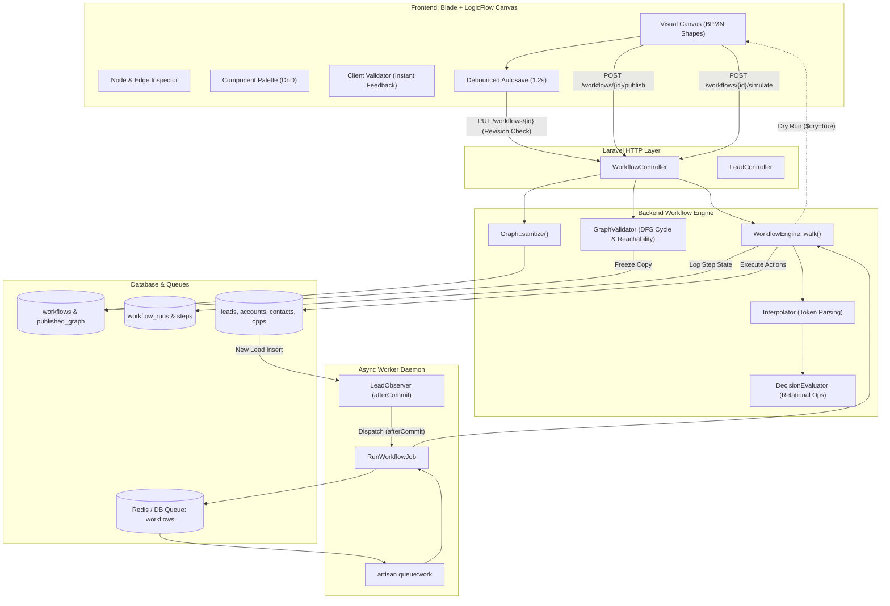

# Lead Workflow Automation Engine & Visual BPMN Builder
**Technical Architecture, Workflow Life Cycles, Feature Blueprint, and LogicFlow vs. React Flow (xyflow) Head-to-Head Analysis**

---

## 1. Executive Summary & Project Overview

The **Lead Workflow Automation Engine** is an enterprise-grade CRM process automation platform built with **Laravel** on the backend and **LogicFlow (`@logicflow/core` + `@logicflow/extension`)** on the frontend. It bridges the gap between no-code visual workflow orchestration and strict, mission-critical backend execution.

Modern sales organizations require dynamic lead routing, qualification, and lifecycle enforcement—such as round-robin sales development representative (SDR) distribution, automatic Einstein/BANT score threshold evaluation, automated task creation, multi-entity CRM conversion (Account, Contact, Opportunity), and compliant retention/disqualification archiving. 

Instead of hardcoding business rules in procedural code or relying on bloated third-party SaaS tools, this system provides:
1. **Interactive BPMN 2.0-inspired Visual Canvas:** An in-browser workflow builder featuring custom SVG shapes (Start Event, Action Tasks, Decision Gateways, Sticky Notes), smart orthogonal polyline routing, and drag-and-drop authoring.
2. **Draft Autosave with Optimistic Locking:** High-frequency, debounced autosaving protected against multi-tab and multi-user race conditions using revision comparison (`409 Conflict`).
3. **Immutable Version Publishing:** Workflows are designed as drafts and published into frozen, immutable versions. Running or queued lead processes are never mutated by active edits.
4. **Resilient Server-Side Graph Traversal:** A clean graph abstraction engine that validates reachability, catches cycles via Depth-First Search (DFS) graph coloring, interpolates dynamic lead tokens (`{{lead.company}}`), and executes actions with guaranteed idempotency.
5. **Interactive Dry-Run Simulation:** A real-time simulator that passes sample lead personas through the engine without database mutation, animating the execution path and edge flows on the canvas.

---

## 2. System Architecture

The project adheres to a decoupled **Visual Graph Specification <-> Backend Execution Engine** pattern. The diagram below illustrates the end-to-end data and execution flow:



---

### 2.1 Backend Architecture Components

The backend source code is cleanly separated into dedicated domains:

| Component | File Path | Core Responsibility |
| :--- | :--- | :--- |
| **Workflow Controller** | [`WorkflowController.php`](file:///c:/Users/ASUS/Desktop/laravel-lead-workflow/app/Http/Controllers/WorkflowController.php) | Handles HTTP endpoints for CRUD, optimistic locking autosave, graph publication, dry-run simulation, and latest execution lookup. |
| **Graph Model & Sanitizer** | [`Graph.php`](file:///c:/Users/ASUS/Desktop/laravel-lead-workflow/app/Workflows/Graph.php) | Read-only graph query wrapper (nodes, outgoing edges, trigger discovery, branch resolution) + strict AST sanitizer preventing arbitrary client payloads from entering the database. |
| **Graph Validator** | [`GraphValidator.php`](file:///c:/Users/ASUS/Desktop/laravel-lead-workflow/app/Workflows/GraphValidator.php) | Authoritative graph theory validator. Enforces single trigger, terminal node boundaries, dual decision branching (YES/NO), reachability, and acyclicity via a 3-color DFS algorithm. |
| **Workflow Engine** | [`WorkflowEngine.php`](file:///c:/Users/ASUS/Desktop/laravel-lead-workflow/app/Workflows/WorkflowEngine.php) | Traversal engine that walks the graph step-by-step from trigger to terminal step. Supports execution guards (`max_steps = 50`), dry-run mode, and step event callbacks. |
| **Token Interpolator** | [`Interpolator.php`](file:///c:/Users/ASUS/Desktop/laravel-lead-workflow/app/Workflows/Interpolator.php) | Evaluates merge tags like `{{lead.name}}`, `{{company}}`, `{{score}}` inside action configurations before execution. |
| **Decision Evaluator** | [`DecisionEvaluator.php`](file:///c:/Users/ASUS/Desktop/laravel-lead-workflow/app/Workflows/DecisionEvaluator.php) | Evaluates lead attributes against comparison operators (`>=`, `>`, `<=`, `<`, `=`, `!=`, `contains`). |
| **Action Pipeline** | [`NodeAction.php`](file:///c:/Users/ASUS/Desktop/laravel-lead-workflow/app/Workflows/Actions/NodeAction.php) | Standardized contract ensuring all workflow actions are idempotent and respect dry-run execution. |
| **Queue Worker Job** | [`RunWorkflowJob.php`](file:///c:/Users/ASUS/Desktop/laravel-lead-workflow/app/Jobs/RunWorkflowJob.php) | Queued job dispatched per lead and published workflow version. Manages run deduplication, step logging, and retry backoff. |
| **Model Observer** | [`LeadObserver.php`](file:///c:/Users/ASUS/Desktop/laravel-lead-workflow/app/Observers/LeadObserver.php) | Triggers active workflows upon lead creation using `afterCommit = true` to avoid race conditions with uncommitted DB transactions. |

---

### 2.2 Database Schema & Entity Relationships

The data model is partitioned into workflow orchestration tables and CRM entity tables.

#### Workflow Tables
* **`workflows`**: Holds workflow definitions.
  * `graph`: Working draft JSON edited in the builder.
  * `revision`: Optimistic locking integer incremented on each draft save.
  * `published_graph`: Frozen JSON executed by the engine.
  * `published_version`: Monotonically increasing version counter.
  * `status`: `draft`, `active`, or `inactive`.
* **`workflow_runs`**: Represents an execution instance for a specific subject.
  * Unique constraint on `['workflow_id', 'subject_type', 'subject_id', 'version']` ensures that a given lead never runs the same published version twice, guaranteeing execution idempotency.
  * `status`: `running`, `completed`, or `failed`.
* **`workflow_run_steps`**: High-resolution audit log of each individual node visited.
  * Records `node_id`, `node_type`, `branch`, `status`, `output` JSON, `error`, and `executed_at`.

#### CRM Entity Tables
* **`leads`**: Master lead record storing contact details, scoring (`score`), lifecycle `stage`, `owner_id`, `disqualified_reason`, and retention `purge_after`.
* **`activities`**: Timeline touchpoints (discovery calls, emails, notes).
* **`accounts`**: B2B Accounts generated during lead conversion.
* **`contacts`**: B2B Contacts linked to both the Lead and Account.
* **`opportunities`**: Deal pipeline opportunities created upon conversion.

---

### 2.3 Frontend Architecture Components

The browser client is assembled in vanilla ES modules bundled by Vite:

```
resources/
├── js/
│   └── workflow/
│       ├── api.js         # REST client (save, publish, simulate, runs)
│       ├── builder.js     # LogicFlow instance, custom SVG nodes, toolbar, modals
│       ├── nodes.js       # Node metadata, schemas, default configurations, colors
│       └── validate.js    # Client-side graph validator matching server logic
├── css/
│   └── workflow.css       # Custom design system, canvas styling, inspector themes
└── views/
    └── workflows/
        ├── builder.blade.php  # Canvas viewport, inspector drawer, toolbar modals
        └── index.blade.php    # Workflow dashboard with metrics
```

---

## 3. Core Workflows & Execution Cycles

### 3.1 Design & Canvas Authoring Workflow
1. The user drags a node from the **Component Palette** (`resources/js/workflow/nodes.js`) onto the canvas.
2. LogicFlow's Drag-and-Drop (DND) plugin places the node and fires `node:dnd-add`.
3. If a `trigger` node is added, any existing trigger is automatically replaced (enforcing the single-trigger rule).
4. The user drags connections from outgoing anchors. When connecting from a `decision` gateway, the engine automatically labels the first edge as **"✓ Yes (qualified)"** and the second edge as **"✕ No (disqualified)"**.
5. Selecting any node opens the reactive **Properties Inspector**, displaying custom form controls based on `SCHEMA[type]` with live token interpolation preview.

### 3.2 Optimistic Locking & Autosave Workflow
To allow multi-tab workflows without data loss:
1. Every canvas change (move, property edit, connection) flags `dirty = true` and starts a **1200ms debounce timer**.
2. When the timer elapses, the client sends a `PUT /workflows/{id}` payload with `{ revision: N, graph: cleanData }`.
3. The server runs:
   ```sql
   UPDATE workflows 
   SET graph = :sanitized, revision = revision + 1 
   WHERE id = :id AND revision = :expected_revision;
   ```
4. If another tab saved first, 0 rows are affected. The server returns HTTP **409 Conflict**. The editor halts autosaves and warns the user to reload, preventing silent overwrites.

### 3.3 Two-Tier Validation (Client + Server)
* **Client Pre-check ([`validate.js`](file:///c:/Users/ASUS/Desktop/laravel-lead-workflow/resources/js/workflow/validate.js)):** Validates the graph locally within 350ms of any canvas edit. Problematic nodes receive a red glow and pulse animation, and an issue counter appears in the top navigation.
* **Server Authority ([`GraphValidator.php`](file:///c:/Users/ASUS/Desktop/laravel-lead-workflow/app/Workflows/GraphValidator.php)):** When the user clicks **Publish** or **Simulate**, the backend runs full structural verification:
  * **Trigger Validation:** Exactly one start event (`trigger` or `circle`).
  * **Dead Connection Checks:** Verifies all edge source and target IDs exist in the node set.
  * **Terminal Boundary:** Verifies that terminal steps (`archive`) have zero outgoing edges.
  * **Gateway Completeness:** Verifies that decision nodes have both a `yes` and a `no` outbound edge.
  * **Reachability:** Traverses from the trigger using BFS/queue; flags orphan nodes.
  * **Cycle Detection:** Runs a Depth-First Search with 3-state node coloring:
    * `0 = White (Unvisited)`
    * `1 = Gray (Currently Exploring / In Stack)`
    * `2 = Black (Fully Explored)`
    * If a Gray node is encountered during traversal, a back-edge loop is detected and rejected.

### 3.4 Version Publication & Run Isolation
1. When published, the validated draft `graph` is copied into `published_graph`.
2. The `published_version` integer increments (e.g., from `1` to `2`), and `status` is set to `active`.
3. In-flight jobs running version `1` continue executing the immutable `published_graph` snapshot stored when they started.
4. New leads entering the system immediately execute the new `published_version`.

### 3.5 Real-Time Event Trigger & Queued Execution
1. A new lead is created in the database.
2. [`LeadObserver`](file:///c:/Users/ASUS/Desktop/laravel-lead-workflow/app/Observers/LeadObserver.php) intercepts the event. Because `$afterCommit = true`, it waits for the active database transaction to commit completely.
3. The observer finds all active lead workflows and dispatches [`RunWorkflowJob`](file:///c:/Users/ASUS/Desktop/laravel-lead-workflow/app/Jobs/RunWorkflowJob.php) to the `workflows` queue.
4. The queue worker picks up the job and invokes `WorkflowEngine::walk()`:
   * Finds the trigger node.
   * Resolves configuration tokens via `Interpolator::interpolate()`.
   * For decision nodes, evaluates rule expressions via `DecisionEvaluator::passes()`.
   * For action nodes, calls the corresponding action class implementing [`NodeAction`](file:///c:/Users/ASUS/Desktop/laravel-lead-workflow/app/Workflows/Actions/NodeAction.php).
   * Records execution state into `workflow_run_steps`.
   * Determines the next node via `Graph::next($nodeId, $branch)`.

### 3.6 Dry-Run Simulation
1. The user selects a test lead persona (e.g., *Sarah Jenkins, Score 85* or *Dave's Hardware, Score 25*).
2. The client calls `POST /workflows/{id}/simulate`.
3. The backend executes `WorkflowEngine::walk()` with `$dry = true`.
4. Decision logic is executed for real, but action handlers mutate zero database records (they return hypothetical output).
5. The API returns an array of visited node IDs and selected branches.
6. The browser sequentially steps through each node, highlighting visited nodes in green and animating the polyline connector arrows (`lf.openEdgeAnimation(edgeId)`).

---

## 4. Comprehensive Feature Inventory

```
+----------------------------------------------------------------------------------------------------+
|                                    WORKFLOW BUILDER FEATURES                                       |
+------------------------------------+----------------------------------+----------------------------+
| Visual Modeling                    | Engine & Reliability             | Enterprise Productivity    |
+------------------------------------+----------------------------------+----------------------------+
| * Native BPMN SVG Custom Nodes     | * Optimistic Lock (409 Guard)    | * Topological Auto-Layout  |
| * Orthogonal Polyline Auto-Routing | * Immutable Version Freezing     | * Navigator MiniMap        |
| * Custom Decision Yes/No Badges    | * Asynchronous Queue Pipeline    | * PNG Blueprint Export     |
| * Reactive Properties Inspector    | * Step Audit Logging             | * JSON Import / Export     |
| * Inline Sticky Note Annotations   | * DFS Acyclic Cycle Detection    | * Visual Phase Swimlanes   |
| * Color-Blind Accessible Connectors| * Idempotent Action Handlers     | * Keyboard Shortcut Suite  |
| * Live Token Replacement Previews  | * Dry-Run Simulation Animator    | * Version Restore to Draft |
+------------------------------------+----------------------------------+----------------------------+
```

### Detailed Node Registry

| Node Type | BPMN Shape | Accent Color | Action Description |
| :--- | :--- | :--- | :--- |
| **`trigger`** | Circle (`r=48`) | `#7c3aed` (Purple) | Start event; listens for inbound `Lead.Created` events from Webhooks, API, or Forms. |
| **`assign`** | Rect (`240x96`) | `#2563eb` (Blue) | Assigns lead owner via Territory Round-Robin (cached atomic increment) or specific sales rep. |
| **`activity`** | Rect (`240x96`) | `#0d9488` (Teal) | Automatically logs a 15-minute discovery call, email sequence, or demo meeting on the CRM timeline. |
| **`stage`** | Rect (`240x96`) | `#0891b2` (Cyan) | Advances lead status (e.g., `New` -> `Working - Contacted` -> `Sales Qualified`). |
| **`decision`** | Diamond (`rx=120, ry=75`)| `#d97706` (Amber) | Gateway evaluating conditional operators (`>=`, `<=`, `contains`) on lead attributes. |
| **`convert`** | Rect (`240x96`) | `#16a34a` (Green) | Marks lead status as `converted` and locks the record. |
| **`account`** | Rect (`240x96`) | `#059669` (Emerald) | Generates linked B2B Account, Contact, and Opportunity records in a single database transaction. |
| **`disqualify`** | Rect (`240x96`) | `#dc2626` (Red) | Sets lead status to `disqualified` with categorized reason codes. |
| **`archive`** | Rect (`240x96`) | `#64748b` (Slate) | Terminal node: Moves lead to cold nurture storage and calculates a future purge timestamp. |
| **`sticky_note`**| Post-It Rect (`180x120`) | `#eab308` (Yellow) | Non-executing annotation card for workflow documentation, instructions, and engineering notes. |

---

## 5. Head-to-Head Comparison: Why LogicFlow is Better than React Flow (xyflow)

When architecting a workflow builder for a modern full-stack application (such as Laravel, Ruby on Rails, Django, or enterprise micro-frontends), selecting the diagramming foundation is a pivotal architectural decision. 

While **React Flow (now branded as xyflow)** is widely known in the React-only single-page application ecosystem, **LogicFlow (`@logicflow/core`)** offers substantial advantages for business process modeling, BPMN diagramming, and full-stack integration.

---

### 5.1 The 10 Decisive Dimensions

#### 1. Framework Independence vs. Mandatory React Runtime Coupling
* **React Flow (xyflow):** Completely tied to the React framework. Using React Flow in a Laravel/Blade, Django, Rails, or ASP.NET MVC project requires bundling `react`, `react-dom`, React state reconcilers, and JSX build steps. This forces a heavy, isolated "island" of React that cannot directly communicate with server templates without complex bridging.
* **LogicFlow:** Completely **framework-agnostic**. Written in pure TypeScript and native SVG/HTML5 DOM, it mounts directly into any server-rendered container:
  ```javascript
  const lf = new LogicFlow({ container: document.getElementById('lf') });
  ```
  It integrates cleanly into standard Vite or Webpack setups with zero framework overhead, zero React version mismatches, and zero peer-dependency conflicts.

#### 2. Native BPMN/Workflow Semantics vs. Generic Unopinionated Graph Primitives
* **React Flow (xyflow):** A generic canvas for connecting arbitrary DOM nodes. It has no built-in awareness of business processes. To build standard BPMN diagrams, you must hand-code custom SVG path definitions for diamond gateways, start circles, task cards, multi-point anchors, and condition routing from scratch.
* **LogicFlow:** Built specifically for **business process workflows, flowcharts, and BPMN 2.0**. It ships with native primitives:
  * `CircleNodeModel` & `CircleNode` (BPMN Start/End Events)
  * `DiamondNodeModel` & `DiamondNode` (BPMN Decision Gateways)
  * `RectNodeModel` & `RectNode` (Activity Tasks)
  * `PolylineEdgeModel` & `PolylineEdge` (Sequence Flows)
  All shape geometry, inner bounding radius, anchor distribution, and boundary math are solved out of the box.

#### 3. True Object-Oriented Model-View Separation (MVVM) vs. Hook-Driven Monoliths
* **React Flow (xyflow):** Custom nodes are React functional components. As graphs scale, state changes inside one node or handle can trigger cascading virtual DOM diffs and re-renders across the canvas unless every component and callback is aggressively wrapped in `React.memo`, `useCallback`, and `useMemo`.
* **LogicFlow:** Uses a clean, object-oriented **Model-View architecture**:
  ```javascript
  class DecisionModel extends DiamondNodeModel {
    setAttributes() { this.rx = 120; this.ry = 75; }
    // Node rules, anchor distribution, validation
  }
  class DecisionView extends DiamondNode {
    getShape() { return h('g', ...); } // Direct SVG Virtual DOM
  }
  ```
  Data rules and constraints live in the **Model**; visual rendering lives in the **View**. This separation isolates graph topology from visual updates, drastically simplifying codebase maintenance.

#### 4. Smart Orthogonal Polyline Routing & Midpoint Label Positioning
* **React Flow (xyflow):** Edge routing is notoriously rudimentary. Default `smoothstep` or `bezier` connectors frequently cross awkwardly over unrelated nodes or render overlapping labels. Implementing true orthogonal routing that avoids nodes requires integrating external heavy layout engines (like Dagre or ELKjs).
* **LogicFlow:** Features **native intelligent polyline routing** (`PolylineEdge`). It automatically calculates clean orthogonal 90-degree turns, allows users to drag and adjust connector bends, and automatically positions edge labels (`getTextPosition()`) along the longest segment of the line.

#### 5. Native Anchor Management & Declarative Connection Rules
* **React Flow (xyflow):** Handles (ports) are DOM elements attached to nodes. Enforcing rules (e.g., "A trigger cannot have incoming edges" or "A decision node must not allow more than 2 outputs") requires imperatively checking connections inside the `onConnect` callback and manually reverting state.
* **LogicFlow:** Provides declarative anchor models and native rule validation directly on the node model:
  ```javascript
  class TriggerModel extends CircleNodeModel {
    setAttributes() {
      this.targetRules.push({
        message: 'A trigger cannot have incoming connections',
        validate: () => false,
      });
    }
  }
  ```
  If an invalid connection is attempted, LogicFlow intercepts it before edge creation, prevents the link, and triggers the `connection:not-allowed` event automatically.

#### 6. Batteries-Included Enterprise Tooling vs. Fragmented Add-ons
* **React Flow (xyflow):** Core features like undo/redo stacks, snapshot exports, snaplines, and shape drag-and-drop palettes must be assembled manually or via third-party community packages.
* **LogicFlow:** Ships with an official, synchronized enterprise extension suite (`@logicflow/extension`):
  * `MiniMap`: Interactive canvas overview navigator with viewport panning.
  * `Snapshot`: Full-canvas export to PNG, JPEG, or SVG with custom backgrounds.
  * `Dnd`: Native drag-and-drop registry for component palettes.
  * `Snapline`: Alignment guides that snap nodes to grid coordinates during drag.
  * `History`: Integrated undo/redo history management with automatic state snapshots.

#### 7. Rendering Performance & DOM Footprint
* **React Flow (xyflow):** Each node is a full HTML DOM subtree wrapped inside React's synthetic event system. In complex diagrams with hundreds of nodes and custom form fields, the sheer number of nested DOM elements creates significant memory overhead and scroll stutter.
* **LogicFlow:** Renders diagram elements as **direct, lightweight SVG elements** using a high-performance hyperscript virtual DOM (`h()`). SVG transforms (`translate`, `scale`) are handled natively by the browser's graphics layer, ensuring smooth 60 FPS panning, zooming, and animation even on large workflow graphs.

#### 8. Native Data Structure Synergy with Backend Engines
* **React Flow (xyflow):** Uses a React-centric schema where properties are nested under `data`, handles are split into separate `sourceHandle` strings, and positions require specific structures:
  ```json
  { "id": "1", "position": { "x": 0, "y": 0 }, "data": { "label": "Node" } }
  ```
* **LogicFlow:** Stores graph specifications in an industry-standard, flat format:
  ```json
  {
    "nodes": [{ "id": "n1", "type": "rect", "x": 100, "y": 100, "properties": {} }],
    "edges": [{ "id": "e1", "type": "polyline", "sourceNodeId": "n1", "targetNodeId": "n2", "properties": {} }]
  }
  ```
  This format maps 1:1 with standard graph theory representations (adjacency lists) and is deserialized directly into backend PHP classes ([`Graph.php`](file:///c:/Users/ASUS/Desktop/laravel-lead-workflow/app/Workflows/Graph.php)) without requiring transformation layers.

#### 9. Bundle Size & Build Complexity
* **React Flow (xyflow):** Pulls in `@xyflow/react` (~80KB min+gzip) + `react` & `react-dom` (~45KB min+gzip) + build plugins = **~130KB-160KB minimum overhead** added to your production JavaScript bundle.
* **LogicFlow:** `@logicflow/core` and `@logicflow/extension` bundle down to a fraction of that size without requiring external runtime frameworks. The Vite build runs faster and requires zero JSX transpilation pipelines.

#### 10. Direct DOM Event Handling & Accessibility
* **LogicFlow:** Renders proper ARIA roles and graphic semantics directly on node groups:
  ```javascript
  getOuterGAttributes() {
    return {
      'data-nid': this.id,
      role: 'graphics-symbol',
      'aria-label': `${title}: Decision gateway evaluating ${ruleText}. Branches: Yes or No.`,
      tabIndex: 0,
    };
  }
  ```
  Screen readers, automated UI test suites (e.g., Playwright, Cypress), and custom CSS animations interact with standard SVG nodes without having to pierce through React component boundaries.

---

### 5.2 Direct Feature Comparison Matrix

| Feature / Capability | LogicFlow (`@logicflow/core`) | React Flow (`@xyflow/react`) | Winner & Justification |
| :--- | :---: | :---: | :--- |
| **Framework Agnosticism** | **100% Framework-Free** (Pure TS/JS, mounts anywhere) | **React Exclusive** (Requires React 18+ runtime) | **LogicFlow:** Seamless integration with Laravel Blade, Rails, Django, or pure HTML. |
| **BPMN 2.0 Shapes** | **Native** (Circles, Diamonds, Rectangles, Polyline) | **Custom Manual SVG** (Developer must build shapes) | **LogicFlow:** Native shape models with correct geometric bounding boxes. |
| **Edge Routing Quality** | **Orthogonal Polyline** with draggable bend points | `smoothstep` / `bezier` (Prone to overlapping) | **LogicFlow:** Clean 90-degree flowchart connectors out of the box. |
| **Anchor/Port Validation** | **Declarative Rules** (`targetRules`, `sourceRules`) | Manual callback checking (`isValidConnection`) | **LogicFlow:** Prevents invalid connections before they occur. |
| **Undo / Redo Stack** | **Built-in** (`history: true`, `lf.undo()`, `lf.redo()`) | Manual implementation required | **LogicFlow:** Zero-configuration command history. |
| **MiniMap Navigator** | **Official Extension** (`MiniMap` module) | Available as separate component | **Tie:** Both provide functional minimaps. |
| **Snapshot / Export** | **Built-in** (`lf.getSnapshot('name.png')`) | Requires `html-to-image` or canvas hacks | **LogicFlow:** Official extension with background styling. |
| **Data Schema Cleanliness** | Flat `{ nodes, edges }` with native properties | Nested `data` object with handle identifiers | **LogicFlow:** Direct 1:1 match with backend Graph AST. |
| **Bundle Footprint** | Lightweight, zero framework dependencies | Heavy (React + React-DOM required) | **LogicFlow:** Much lighter bundle with faster cold loads. |
| **Visual Node Customization** | Model-View OO inheritance (`NodeModel` + `View`) | Functional React Components | **LogicFlow:** Clear separation of layout math and SVG rendering. |

---

## 6. Developer Guide: Extending the System

Adding a new workflow action (e.g., sending an SMS or calling an external Webhook) requires just three simple steps across backend and frontend:

### Step 1: Create the Backend Action Class
Create a new PHP class implementing [`NodeAction`](file:///c:/Users/ASUS/Desktop/laravel-lead-workflow/app/Workflows/Actions/NodeAction.php):

```php
<?php

namespace App\Workflows\Actions;

use App\Models\Lead;
use Illuminate\Support\Facades\Http;

class SendSlackNotification implements NodeAction
{
    public function handle(Lead $lead, array $config, bool $dry): array
    {
        $channel = $config['channel'] ?? '#leads-alerts';
        $message = "New high-value lead: {$lead->name} ({$lead->company})";

        if ($dry) {
            return ['channel' => $channel, 'message' => $message, 'simulated' => true];
        }

        Http::post(config('services.slack.webhook_url'), [
            'channel' => $channel,
            'text'    => $message,
        ]);

        return ['channel' => $channel, 'delivered' => true];
    }
}
```

### Step 2: Register in Backend Configuration
Add the action key and mapping to [`config/workflows.php`](file:///c:/Users/ASUS/Desktop/laravel-lead-workflow/config/workflows.php):

```php
return [
    'actions' => [
        // ... existing actions
        'slack' => Actions\SendSlackNotification::class,
    ],
    'terminal' => ['archive'],
    'max_steps' => 50,
];
```

### Step 3: Register in Frontend Node Catalog
Add the node metadata, default values, and inspector form schema to [`resources/js/workflow/nodes.js`](file:///c:/Users/ASUS/Desktop/laravel-lead-workflow/resources/js/workflow/nodes.js):

```javascript
// 1. Add Type definition
TYPES.slack = {
  kind: 'Action',
  category: 'Notifications',
  title: 'Send Slack Notification',
  desc: 'Dispatches automated alert to team Slack channel.',
  shape: 'rect',
};

// 2. Add Default Config
DEFAULT_CONFIG.slack = { channel: '#leads-alerts' };

// 3. Add Inspector Form Schema
SCHEMA.slack = [
  { key: 'channel', label: 'Slack Channel', type: 'text' }
];

// 4. Assign to Palette Group
GROUPS[1][1].push('slack');
```

Once saved, the new node immediately appears in the canvas palette, supports full property inspection, automatically works with autosave, passes server validation, and executes seamlessly inside queued production runs.

---

## 7. Verification & Production Deployment

To run and verify the complete workflow system locally or in production:

```bash
# 1. Install dependencies
composer install
npm install

# 2. Build frontend assets
npm run build   # or npm run dev for local HMR

# 3. Run database migrations
php artisan migrate

# 4. Start the queue worker for workflow processing
php artisan queue:work --queue=workflows,default --tries=3 --backoff=10,60

# 5. Access the visual builder
# Open http://localhost:8000/workflows in your browser
```

---

## 8. Conclusion

The combination of **Laravel** and **LogicFlow** provides a clean, decoupled, and robust foundation for enterprise workflow automation. 

By leveraging **LogicFlow** over React Flow, the project avoids framework bloat, guarantees seamless integration with Laravel's Blade and Vite ecosystem, gains native BPMN diagramming semantics with intelligent orthogonal polyline routing, and maintains a strict 1:1 data alignment with the backend graph engine.
